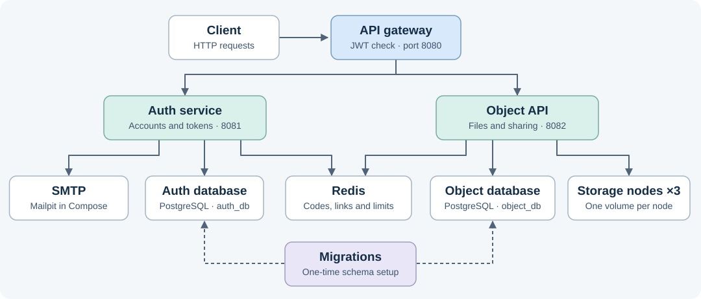

# CloudBin

CloudBin is a Go backend for uploading, downloading, and sharing files. The gateway routes requests, the auth service manages accounts, and the object API records file ownership and placement in PostgreSQL. By default, each upload is copied to two of the three storage nodes.

## Documentation

- [Run CloudBin locally](docs/getting-started.md) · [Architecture and file lifecycle](docs/architecture.md)
- [API gateway](docs/services/api-gateway.md) · [Auth service](docs/services/auth-service.md) · [Object API](docs/services/object-api.md) · [Storage nodes](docs/services/storage-node.md)
- [Import the Postman collection](docs/postman/CloudBin.postman_collection.json) · [Run the API checks](docs/postman/README.md)
