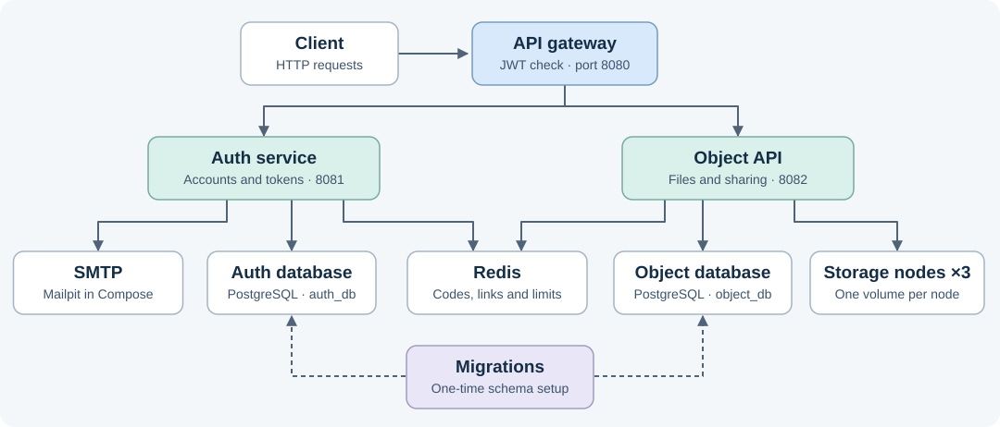

# Architecture

The gateway validates bearer JWTs on protected routes and forwards account requests to the auth service and file requests to the object API. The auth service owns `auth_db`, which holds users, password hashes and token records. The object API owns `object_db`, which holds file metadata, permissions, storage locations and pending cleanup work. Each storage node has its own volume for file bytes.

Redis holds short-lived registration and password-reset codes, token revocation markers, share links and rate-limit counters. The auth service checks revocation markers on its protected routes. The gateway verifies JWT signatures and claims locally. The object API can keep share links and rate-limit counters in process memory if it starts without Redis. SMTP delivers account messages, with Mailpit available for local testing.

## Follow an upload

1. A client sends a file to the gateway. The object API accepts up to 20 MiB and uses the owner ID and object key to choose distinct nodes on an FNV-1a hash ring with 50 virtual positions per node.
2. The object API reserves a fresh storage key and records all destinations in PostgreSQL. It writes the complete file to each selected node in parallel.
3. Once every node accepts its copy, a database transaction publishes the new version, its checksum (ETag) and its locations. A failed overwrite leaves the previous version readable. Competing writers can receive HTTP 409 and retry.
4. A download looks up the published version, opens the primary copy and tries the recorded replica if the primary cannot be opened. Public downloads require a visible, public-read object. A temporary share token grants access to a visible object until the token expires.
5. Deletion removes the published record and queues its copies for cleanup. A worker checks every minute for abandoned, replaced or deleted versions that have passed the one-hour grace period.

## Database setup and upgrades

Compose runs the migration job against both PostgreSQL databases before starting the application services. The optional seed job creates verified admin and demo accounts. When upgrading an existing installation, quiesce older object API writers and apply object migration `000002` before deploying the versioned writer. Existing objects remain readable through their legacy storage keys.

[Upload and publish](../object-api/internal/object/service/service.go) · [Placement](../object-api/internal/object/service/placement.go) · [Transactions and cleanup](../object-api/internal/object/repository/postgres.go) · [Migration SQL](../migrations/object)
